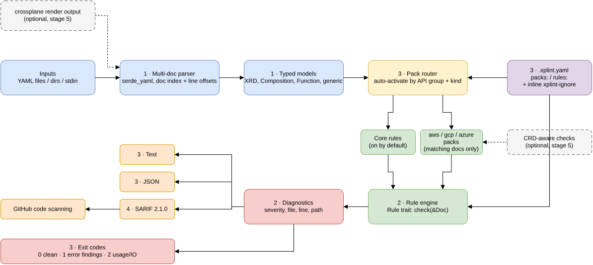

<p align="center">
  
</p>

# xplint

Opinionated linter for Crossplane (v1 and v2 pipeline-mode) XRDs, Compositions, Functions and rendered output. Written in Rust.

**Status: Stage 4 done.** The `xplint` binary lints files and directories, supports `--format text|json|sarif`, `.xplint.yaml` config, inline ignores and exit codes.

## Why
Existing tools cover other layers:

| Tool | Covers | Gap |
|---|---|---|
| [crossplane-contrib/crossplane-lint](https://github.com/crossplane-contrib/crossplane-lint) (Go) | Patch-and-transform era Compositions | Roadmap items unfinished; little pipeline-mode coverage |
| `crossplane beta validate` | Schema validation | No policy or style rules |
| `crossplane render` | Renders output locally | Not a linter |
| xprin | Test framework | Not a linter |

xplint targets opinionated policy rules and pipeline-mode coverage. It is also a vehicle for learning Rust (serde, traits, schema walking, clap, SARIF).

## Flow


*Rendered from docs/xplint-flow.drawio — open in draw.io to edit.*

## Rules
Core rules are provider-neutral and always on. Provider packs (`aws`, `gcp`, `azure`) auto-activate per document by API group (any version) plus the rule's kind list; the mechanism is implemented and tested (with a test-registered rule, see `tests/packs.rs`), but no provider rules ship yet (stage 5).

| Rule | Pack | Severity | Checks |
|---|---|---|---|
| `xrd-required-without-default` | core | warning | XRD spec field listed in `required` without a schema `default` |
| `composition-missing-function` | core | error | pipeline step references a function that no loaded `Function` declares (silent if no Function is loaded) |
| `composition-missing-deletion-policy` | core | warning | composed resource `base` sets neither `deletionPolicy` nor `managementPolicies` (an explicit `managementPolicies` counts as satisfying) |
| `patch-path-not-in-xrd` | core | error | composite-side patch `fromFieldPath`/`toFieldPath` not in the XRD OpenAPI schema (skipped if the XRD is not loaded) |

See [examples/](examples/README.md) for sets that trigger each rule.

## Usage
```
xplint [PATHS...]                    # files or directories (recursive .yaml/.yml); default: .
xplint --format text|json|sarif      # default: text
xplint --config path/to/config.yaml  # default: ./.xplint.yaml if present
```
All paths are loaded as one corpus, so Functions and XRDs are resolved across files.
`--render` arrives in a later stage.

Text output is one `file:line: severity [rule] message (yaml.path)` per finding, sorted by file and line, then a `N error(s), M warning(s)` summary (nothing is printed when clean). JSON output is an array of `{rule, severity, file, line, path, message}` objects (`[]` when clean).

SARIF output (`--format sarif`) is SARIF 2.1.0 with one run: `tool.driver` (`name`, `version` from the crate, `informationUri`, and `rules[]` listing every registered rule with `id`, `shortDescription` and `defaultConfiguration.level`), and `results[]` with `ruleId`, `ruleIndex`, `level` (after config overrides), `message.text` and a `physicalLocation` (relative forward-slash `artifactLocation.uri`, `region.startLine`). Exit codes are the same as for the other formats. To upload to GitHub code scanning see [docs/sarif-upload.md](docs/sarif-upload.md).

**What is schema-validated:** `tests/sarif.rs` validates real CLI output (the `examples/` set, a clean run, a config override) and library output for pack rules of AWS, GCP and Azure documents against the vendored official SARIF 2.1.0 JSON schema (`tests/fixtures/sarif-schema-2.1.0.json`, draft-04, via the `jsonschema` dev-dependency), and compares against checked-in snapshots. **Not covered:** an actual upload to GitHub code scanning (GitHub applies extra requirements beyond the schema); no provider rules ship yet, so pack results are tested with test-registered rules.

**Tests are local and static.** All fixtures and tests are YAML files and in-process/binary runs; pack and SARIF tests are parametrized over AWS (`rds.aws.upbound.io`), GCP (`sql.gcp.upbound.io`) and Azure (`dbforpostgresql.azure.upbound.io`). No test or documented command touches cloud resources: no `aws`/`gcloud`/`az` CLI, no terraform/crossplane apply, no cluster/kubectl/kind.

### Exit codes
| Code | Meaning |
|---|---|
| 0 | clean, or warnings only |
| 1 | at least one finding at error level (after config overrides and ignores) |
| 2 | usage error, unreadable/malformed YAML, or invalid config (unknown rule or pack, bad value, missing `--config` file); message on stderr |

### Config: `.xplint.yaml`
```yaml
rules:                       # any rule, core or pack
  xrd-required-without-default: off        # disable
  composition-missing-function: warning    # override severity (warning | error)
packs:                       # whole packs only: aws, gcp, azure
  aws: off                   # `on` is the default and does not force activation
```
- Packs auto-activate per document by API group (any version) and the rule's kinds, e.g. `rds.aws.upbound.io/v1beta1` `Instance` activates `aws`. `off` disables the pack; `on` never applies pack rules to documents outside the pack's groups.
- `core` is not a pack toggle: `packs: {core: off}` is an error. Disable core rules individually under `rules:`.
- Unknown rule or pack names, unknown top-level keys and bad values exit 2 with a message naming the file and the offending name.
- `on`/`off` and YAML booleans are accepted for packs; `false` also works for a rule.

### Inline ignores
`# xplint-ignore: rule-a, rule-b`
- trailing on a line: suppresses findings reported on that line;
- on its own line: suppresses findings reported on the next line;
- in a document's header (comment lines before its first content line, e.g. right after `---`): suppresses those rules for that whole document only.

The pack mechanism is exercised in `tests/packs.rs` with a test-registered AWS rule, since no AWS rules ship before Stage 5.

## Run manually
Commands below were run from the repo root with Rust 1.98.0 (output trimmed where noted).

```
$ cargo fmt --check && cargo clippy --all-targets --locked -- -D warnings
    Finished `dev` profile [unoptimized + debuginfo] target(s) in 2.11s

$ cargo test --locked
test result: ok. 32 passed; 0 failed   (unit: config, ignore, model, loader, yamlpath, rules/engine/packs)
test result: ok. 3 passed; 0 failed    (bin: clap definition)
test result: ok. 21 passed; 0 failed   (tests/cli.rs)
test result: ok. 1 passed; 0 failed    (tests/examples.rs)
test result: ok. 8 passed; 0 failed    (tests/loader.rs)
test result: ok. 5 passed; 0 failed    (tests/packs.rs; aws, gcp, azure)
test result: ok. 7 passed; 0 failed    (tests/rules.rs)
test result: ok. 6 passed; 0 failed    (tests/sarif.rs; schema validation + snapshots)

$ target/debug/xplint examples --format sarif | head -9; echo "exit=${PIPESTATUS[0]}"
{
  "$schema": "https://json.schemastore.org/sarif-2.1.0.json",
  "version": "2.1.0",
  "runs": [
    {
      "tool": {
        "driver": {
          "name": "xplint",
          "version": "0.1.0",
exit=1

$ target/debug/xplint examples/clean --format sarif | tail -5; echo "exit=${PIPESTATUS[0]}"
      "results": []
    }
  ]
}
exit=0

$ target/debug/xplint examples; echo "exit=$?"
examples/violations/missing-deletion-policy/composition.yaml:22: warning [composition-missing-deletion-policy] composed resource 'bucket' sets neither deletionPolicy nor managementPolicies (spec.pipeline[0].input.resources[0].base.spec)
examples/violations/missing-function/composition.yaml:20: error [composition-missing-function] step 'patch-and-transform' references function 'function-not-installed' which is not declared by any loaded Function (spec.pipeline[0].functionRef.name)
examples/violations/patch-path-not-in-xrd/database.yaml:56: error [patch-path-not-in-xrd] path 'spec.sizee' is not defined in the XRD schema (spec.pipeline[0].input.resources[0].patches[0].fromFieldPath)
examples/violations/patch-path-not-in-xrd/database.yaml:60: error [patch-path-not-in-xrd] path 'status.endpoint' is not defined in the XRD schema (spec.pipeline[0].input.resources[0].patches[1].toFieldPath)
examples/violations/required-without-default/xrd.yaml:22: warning [xrd-required-without-default] field 'spec.region' is required but has no default (spec.versions[0].schema.openAPIV3Schema.properties.spec.required[1])
3 error(s), 2 warning(s)
exit=1

$ target/debug/xplint examples/clean; echo "exit=$?"
exit=0

$ target/debug/xplint examples/violations/missing-deletion-policy examples/clean; echo "exit=$?"
examples/violations/missing-deletion-policy/composition.yaml:22: warning [composition-missing-deletion-policy] composed resource 'bucket' sets neither deletionPolicy nor managementPolicies (spec.pipeline[0].input.resources[0].base.spec)
0 error(s), 1 warning(s)
exit=0

$ target/debug/xplint nope.yaml; echo "exit=$?"
xplint: error: nope.yaml: No such file or directory (os error 2)
exit=2

$ printf 'packs:\n  oracle: off\n' > $TMPDIR/c.yaml && target/debug/xplint examples --config $TMPDIR/c.yaml; echo "exit=$?"
xplint: error: /var/folders/yd/mjk_203n5gdg1788hgwbxvvw0000gn/T//c.yaml: unknown pack `oracle` (known packs: aws, gcp, azure)
exit=2

$ printf 'rules:\n  patch-path-not-in-xrd: warning\n  composition-missing-function: off\n' > $TMPDIR/d.yaml && target/debug/xplint examples --config $TMPDIR/d.yaml; echo "exit=$?"
examples/violations/missing-deletion-policy/composition.yaml:22: warning [composition-missing-deletion-policy] composed resource 'bucket' sets neither deletionPolicy nor managementPolicies (spec.pipeline[0].input.resources[0].base.spec)
examples/violations/patch-path-not-in-xrd/database.yaml:56: warning [patch-path-not-in-xrd] path 'spec.sizee' is not defined in the XRD schema (spec.pipeline[0].input.resources[0].patches[0].fromFieldPath)
examples/violations/patch-path-not-in-xrd/database.yaml:60: warning [patch-path-not-in-xrd] path 'status.endpoint' is not defined in the XRD schema (spec.pipeline[0].input.resources[0].patches[1].toFieldPath)
examples/violations/required-without-default/xrd.yaml:22: warning [xrd-required-without-default] field 'spec.region' is required but has no default (spec.versions[0].schema.openAPIV3Schema.properties.spec.required[1])
0 error(s), 4 warning(s)
exit=0
```

## Roadmap
See [docs/PLAN.md](docs/PLAN.md). CI design: [docs/CI.md](docs/CI.md).

## License
MIT, see [LICENSE](LICENSE).
