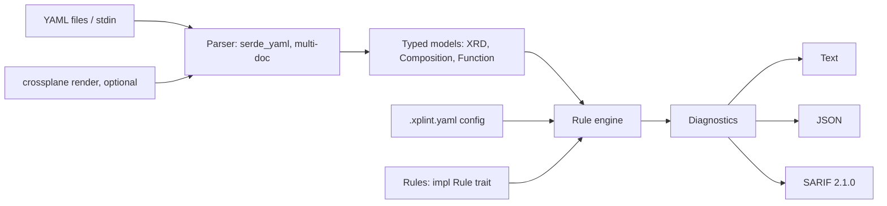

# xplint plan

Goal: an opinionated Rust linter for Crossplane v1 and v2 (pipeline-mode) XRDs, Compositions, Functions and rendered output. Also a Rust learning project.

## Architecture

## Stage 0: Scaffold + CI
- Goal: compiling bin crate with CI.
- Deliverables: Cargo project, pinned toolchain, LICENSE, README, `docs/CI.md`, `ci.yml`.
- Acceptance: `cargo fmt --check`, `clippy -D warnings`, `cargo test --locked` pass locally and in CI.
- Rust: cargo, crates, modules, unit tests, clap derive basics.

## Stage 1: Parse YAML into typed models
- Goal: load multi-document YAML into typed XRD/Composition/Function models.
- Deliverables: serde/serde_yaml deps; `model` module; multi-doc splitter keeping document index and line offsets; unknown kinds kept as generic docs; fixtures under `tests/fixtures`.
- Acceptance: v1 and v2 XRDs, pipeline Compositions and Functions parse; malformed YAML gives an error with file and document number; round-trip tests.
- Rust: serde derive, `Option`, enums with `#[serde(tag)]`/untagged, `Result` and custom error types, `serde_yaml::Value`.

## Stage 2: Rule trait, engine, diagnostics
- Goal: pluggable rules producing located diagnostics.
- Deliverables: `trait Rule { id, severity, check(&Doc) -> Vec<Diagnostic> }`; `Diagnostic { rule, severity, file, line, path, message }`; line resolved from a YAML path; engine running all rules; first four rules (catalog below).
- Acceptance: each rule has pass and fail fixtures; diagnostics sorted by file/line; patch-path rule resolves paths against the XRD OpenAPI schema.
- Rust: traits and trait objects, `Box<dyn Rule>`, lifetimes on borrowed docs, schema tree walking, iterators.

## Stage 3: CLI, exit codes, config
- Goal: usable command line.
- Deliverables: clap subcommands/args (`xplint [PATHS]`, `--format text|json`, `--config`); exit codes (0 clean, 1 findings at error level, 2 usage/IO error); `.xplint.yaml` with enable/disable and severity override; inline ignore comments (`# xplint-ignore: rule-id`).
- Acceptance: directory recursion; exit codes tested with integration tests; ignores honored per line/document.
- Rust: clap derive, `ValueEnum`, `std::process::ExitCode`, `walkdir`-style traversal, integration tests in `tests/`.

## Stage 4: SARIF 2.1.0
- Goal: GitHub code scanning output.
- Deliverables: `--format sarif`; rule metadata in `tool.driver.rules`; example workflow upload step.
- Acceptance: output validates against the SARIF 2.1.0 schema; uploads in a test repo.
- Rust: serde_json, serializing nested structs, `serde(rename)`, snapshot tests.

## Stage 5 (optional): `crossplane render` integration
- Goal: lint rendered managed resources.
- Deliverables: `--render` shells out to `crossplane render`; policy rules on output (RDS deletion protection, no public ingress).
- Acceptance: skipped with a clear message if `crossplane` missing; rules fire on fixtures.
- Rust: `std::process::Command`, error handling across processes, feature flags.

## Stage 6 (optional): Ratatui viewer
- Goal: browse diagnostics interactively.
- Deliverables: `--tui` behind a cargo feature.
- Acceptance: list, filter by severity, open file at line.
- Rust: event loops, state machines, cargo features.

## Rule catalog (planned)
- `xrd-no-required-fields` (stage 2): XRD schema should not mark spec fields `required` without a default; warn.
- `composition-missing-function` (stage 2): pipeline step references a function not declared or not found; error.
- `composition-missing-deletion-policy` (stage 2): composed managed resources lack explicit `deletionPolicy`; warn.
- `patch-path-not-in-xrd` (stage 2): patch `fromFieldPath`/`toFieldPath` not in XRD schema; error.
- `rendered-rds-deletion-protection` (stage 5): RDS instance without `deletionProtection: true`; error.
- `rendered-no-public-ingress` (stage 5): security group ingress from `0.0.0.0/0`; error.
