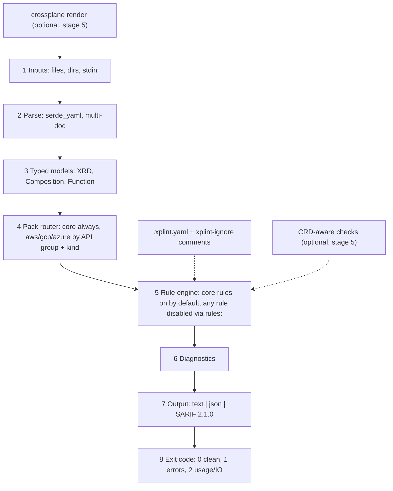

# xplint plan

Goal: an opinionated Rust linter for Crossplane v1 and v2 (pipeline-mode) XRDs, Compositions, Functions and rendered output. Also a Rust learning project.

## Architecture

Numbered 1-to-8 flow diagram (editable): [xplint-flow.drawio](xplint-flow.drawio), rendered as [xplint-flow.png](xplint-flow.png).

## Rule packs
- Core rules are provider-neutral and ON by default. Pack toggles never disable them.
- Provider packs (`aws`, `gcp`, `azure`) are compiled into the single binary and auto-activate per document. Matching is by API group (any version) plus a kind list per rule. Example: `apiVersion: rds.aws.upbound.io/v1beta1` with `kind: Instance` activates the aws pack; a bump to `v1beta2` still matches, so version changes don't deactivate a pack. Zero config by default.
- `.xplint.yaml` has two maps: `packs:` toggles whole packs only (`packs: { aws: on, gcp: off }`); `rules:` disables any individual rule (core or pack) or changes its severity.
- `packs.<name>: on` is the default and means auto-activate for matching documents only; it never applies that pack's rules to non-matching documents (no-op). `off` disables the pack even for matching documents.
- Rationale: no rebuilds, one binary for every team, simple CI. Cargo features are reserved for heavy optional parts (Ratatui TUI, stage 6).
- Roadmap: CRD-aware schema checks that load provider CRDs (like `crossplane beta validate`) for field-level checks on any provider without hand-coded rules (stage 5 optional).

## Stage 0: Scaffold + CI
- Goal: compiling bin crate with CI.
- Deliverables: Cargo project, pinned toolchain, LICENSE, README, `docs/CI.md`, `ci.yml`.
- Acceptance: `cargo fmt --check`, `clippy -D warnings`, `cargo test --locked` pass locally and in CI.
- Rust: cargo, crates, modules, unit tests, clap derive basics.

## Stage 1: Parse YAML into typed models
- Goal: load multi-document YAML into typed XRD/Composition/Function models.
- Deliverables: serde/serde_yaml deps; `model` module; multi-doc splitter keeping document index and line offsets; unknown kinds kept as generic docs; fixtures under `tests/fixtures`.
- Acceptance: v1 and v2 XRDs, pipeline Compositions and Functions parse; malformed YAML gives an error with file and document number; round-trip tests.
- Rust: serde derive, `Option`, enums with `#[serde(tag)]`/untagged, `Result` and custom error types, `serde_yaml::Value`.

## Stage 2: Rule trait, engine, diagnostics
- Goal: pluggable rules producing located diagnostics.
- Deliverables: `trait Rule { id, severity, check(&Doc) -> Vec<Diagnostic> }`; `Diagnostic { rule, severity, file, line, path, message }`; line resolved from a YAML path; engine running all rules with pack-aware rule registration (each rule tagged core or a pack); first four rules (catalog below).
- Acceptance: each rule has pass and fail fixtures; diagnostics sorted by file/line; patch-path rule resolves paths against the XRD OpenAPI schema.
- Rust: traits and trait objects, `Box<dyn Rule>`, lifetimes on borrowed docs, schema tree walking, iterators.

## Stage 3: CLI, exit codes, config
- Goal: usable command line.
- Deliverables: clap subcommands/args (`xplint [PATHS]`, `--format text|json`, `--config`); exit codes (0 clean, 1 findings at error level, 2 usage/IO error); `.xplint.yaml` with a `rules:` map (disable any rule, core or pack, or override severity) and a `packs:` map (toggle whole packs only; core rules cannot be disabled by pack toggles); inline ignore comments (`# xplint-ignore: rule-id`); pack mechanism (`packs:` on/off, auto-activation by API group + kind).
- Acceptance: directory recursion; exit codes tested with integration tests; ignores honored per line/document; pack cases: (a) auto-activation: a doc with `apiVersion: rds.aws.upbound.io/v1beta1`, `kind: Instance` gets aws findings with no config; (b) `packs.aws: off` on that same doc yields no AWS findings; (c) `packs.aws: on` on a non-matching doc (e.g. a plain XRD) yields no AWS findings.
- Rust: clap derive, `ValueEnum`, `std::process::ExitCode`, `walkdir`-style traversal, integration tests in `tests/`.

## Stage 4: SARIF 2.1.0
- Goal: GitHub code scanning output.
- Deliverables: `--format sarif`; rule metadata in `tool.driver.rules`; example workflow upload step.
- Acceptance: output validates against the SARIF 2.1.0 schema; uploads in a test repo.
- Rust: serde_json, serializing nested structs, `serde(rename)`, snapshot tests.

## Stage 5 (optional): `crossplane render` integration
- Goal: lint rendered managed resources.
- Deliverables: `--render` shells out to `crossplane render`; policy rules on output (RDS deletion protection, no public ingress); optional: load provider CRDs for CRD-aware schema checks (field-level, any provider).
- Acceptance: skipped with a clear message if `crossplane` missing; rules fire on fixtures.
- Rust: `std::process::Command`, error handling across processes, feature flags.

## Stage 6 (optional): Ratatui viewer
- Goal: browse diagnostics interactively.
- Deliverables: `--tui` behind a cargo feature.
- Acceptance: list, filter by severity, open file at line.
- Rust: event loops, state machines, cargo features.

## Rule catalog (planned)
- `xrd-required-without-default` (core, stage 2): XRD spec field listed in `required` without a schema default; warn.
- `composition-missing-function` (core, stage 2): pipeline step references a function not declared or not found; error.
- `composition-missing-deletion-policy` (core, stage 2): composed managed resources lack explicit `deletionPolicy`; warn. Note: `deletionPolicy` vs `managementPolicies` behavior differs across Crossplane v1/v2 providers; verify against provider docs before implementing.
- `patch-path-not-in-xrd` (core, stage 2): patch `fromFieldPath`/`toFieldPath` not in XRD schema; error.
- `aws-rds-deletion-protection` (pack: aws, stage 5, rendered output): RDS instance without `deletionProtection: true`; error.
- `aws-no-public-ingress` (pack: aws, stage 5, rendered output): security group ingress from `0.0.0.0/0` or `::/0` (IPv4 and IPv6); error.
